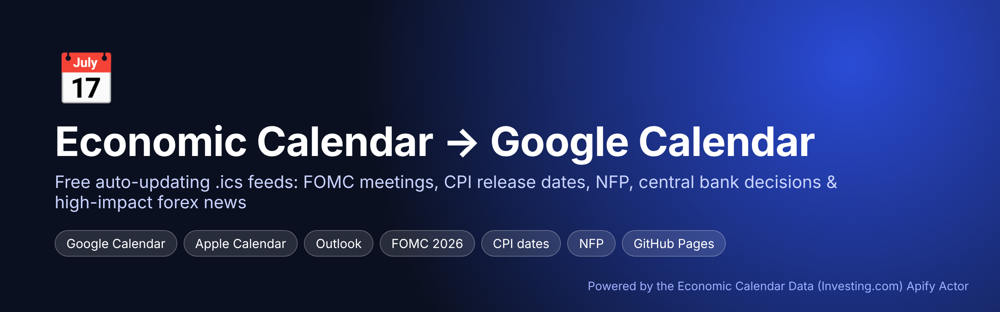
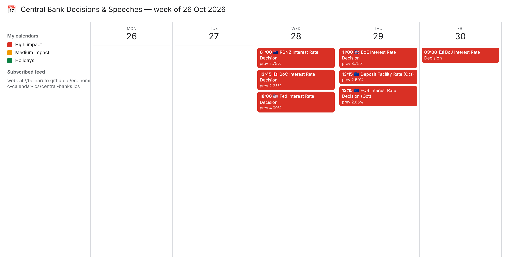
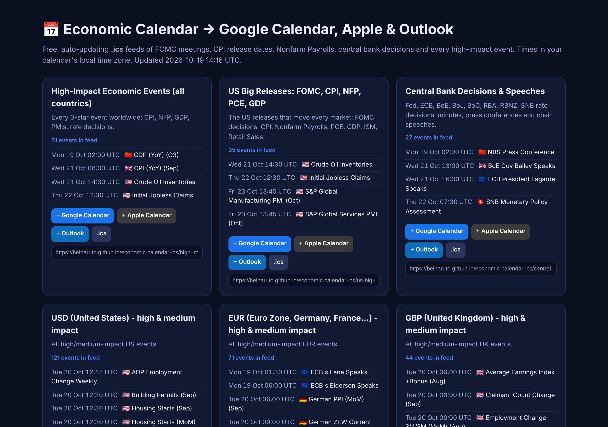

<p align="center"></p>

# Economic Calendar for Google Calendar, Apple Calendar & Outlook (.ics)

**Add the economic calendar to Google Calendar in one click.** This project publishes free, auto-updating `.ics` calendar feeds of the events that move markets — **FOMC meetings & Fed rate decisions, CPI release dates, Nonfarm Payrolls (NFP), PCE, GDP, central bank decisions, high-impact forex news and bank holidays** — and hosts them on GitHub Pages so anyone can subscribe from Google Calendar, Apple Calendar (iPhone/Mac) or Outlook.

**🔗 Live subscribe page: https://belnaruto.github.io/economic-calendar-ics/**

Data comes from the Investing.com economic calendar via the **[Economic Calendar Data (Investing.com) Apify Actor](https://apify.com/pintostudio/economic-calendar-data-investing-com)**.

- ✅ Times shown in **your own time zone** (feeds are in UTC, calendars convert automatically)
- ✅ **15-minute reminders** before every high-impact release
- ✅ Actual / forecast / previous values in each event (updated after the release)
- ✅ Refreshes every 6 hours with GitHub Actions — no server, no cost beyond Actor results
- ✅ 8 ready-made feeds, easy to add your own (any of 97 countries, any keyword)

<p align="center"></p>

## Feeds included

| Feed | What's inside | File |
|---|---|---|
| **High-impact events (all countries)** | Every 3-star event: CPI, NFP, GDP, PMIs, rate decisions | `high-impact.ics` |
| **US big releases** | FOMC / Fed rate decision, CPI, Core CPI, NFP, unemployment, PCE, GDP, ISM, retail sales | `us-big-releases.ics` |
| **Central banks** | Fed, ECB, BoE, BoJ, BoC, RBA, RBNZ, SNB decisions, minutes, press conferences, chair speeches | `central-banks.ics` |
| **USD / EUR / GBP / JPY** | High & medium-impact events per currency (forex traders) | `usd.ics`, `eur.ics`, `gbp.ics`, `jpy.ics` |
| **Bank holidays** | Public holidays when local markets are closed | `bank-holidays.ics` |

<p align="center"></p>

## How to subscribe

1. Open the subscribe page: `https://<your-user>.github.io/economic-calendar-ics/`
2. Click **+ Google Calendar**, **+ Apple Calendar** or **+ Outlook** on the feed you want.

Manual way in Google Calendar: *Other calendars → + → From URL →* paste the `.ics` URL.
On iPhone: *Settings → Calendar → Accounts → Add Account → Other → Add Subscribed Calendar.*

> Google Calendar refreshes subscribed calendars on its own schedule (usually every few hours).

## Host your own feeds (5 minutes)

1. **Fork** this repository (or click *Use this template*).
2. Create a free Apify account and copy your API token from [Apify Console → Settings → Integrations](https://console.apify.com/settings/integrations).
3. In your fork: *Settings → Secrets and variables → Actions → New repository secret* → name `APIFY_TOKEN`.
4. *Settings → Pages →* Source: **GitHub Actions**.
5. *Actions → Update calendar feeds → Run workflow.* Your feeds are live at `https://<your-user>.github.io/<repo>/`.

Without the secret the workflow still publishes demo feeds from `tests/sample-events.json`, so you can see how it works first.

## Run locally

```bash
git clone https://github.com/BelNaruto/economic-calendar-ics
cd economic-calendar-ics
pip install -r requirements.txt

# offline demo with real sample data
python -m econcal_ics.build --out public --sample tests/sample-events.json

# live data from the Apify Actor
export APIFY_TOKEN=apify_api_xxx
python -m econcal_ics.build --out public --days-ahead 60
```

Open `public/index.html`, or import any `public/*.ics` file into your calendar.

## Make your own feed

Feeds are plain Python predicates in [`econcal_ics/feeds.py`](econcal_ics/feeds.py):

```python
Feed("oil", "Oil & Energy", "EIA crude inventories, OPEC, rig counts",
     lambda e: any(k in e.title for k in ("Crude", "OPEC", "Rig Count")))
```

Every event has `country`, `currency`, `importance` (`high`/`medium`/`low`), `title`, `when` (UTC), `actual`, `forecast`, `previous`.

## How it works

```
GitHub Actions (every 6h) ──► Apify API ──► Economic Calendar Data (Investing.com) Actor
                                                      │ JSON events
                              econcal_ics.build ◄─────┘
                                     │  .ics + index.html
                              GitHub Pages ──► Google Calendar / Apple / Outlook subscribers
```

The Actor is called with `run-sync-get-dataset-items` and these inputs (see [actor input](https://apify.com/pintostudio/economic-calendar-data-investing-com/input-schema)):

```json
{ "fromDate": "2026-10-12", "toDate": "2026-11-30", "timeFilter": "time_only" }
```

**Cost:** the Actor is pay-per-result (about $10 per 1,000 events). A 7-weeks-ahead, all-countries refresh is ~1,500 events; to cut cost, pass `countries`/`importance` filters in `econcal_ics/client.py` → `load_events(...)` or refresh less often.

## FAQ

**When is the next FOMC meeting / CPI release / NFP?** Subscribe to `us-big-releases.ics` — every FOMC rate decision, CPI and Nonfarm Payrolls date for 2026 shows up in your calendar with the forecast and previous value.

**Is there a free economic calendar API?** The [Apify Actor](https://apify.com/pintostudio/economic-calendar-data-investing-com) returns the Investing.com calendar as JSON for any country, date range and importance; Apify's free plan includes monthly credits to try it.

**Which time zone are events in?** Feeds are UTC; Google/Apple/Outlook show them in your local time zone automatically.

## Related projects

- [economic-calendar-alert-bot](https://github.com/BelNaruto/economic-calendar-alert-bot) — Telegram & Discord bot for high-impact news alerts
- [economic-calendar-dashboard](https://github.com/BelNaruto/economic-calendar-dashboard) — "economic calendar this week" web dashboard with FOMC/CPI/NFP countdowns
- [economic-calendar-python](https://github.com/BelNaruto/economic-calendar-python) — Python API client, CLI, Excel/CSV export and news filter for backtests

## Disclaimer

For information only, not investment advice. Event data © its original publishers; collected via the Apify Actor above. Licensed MIT.
